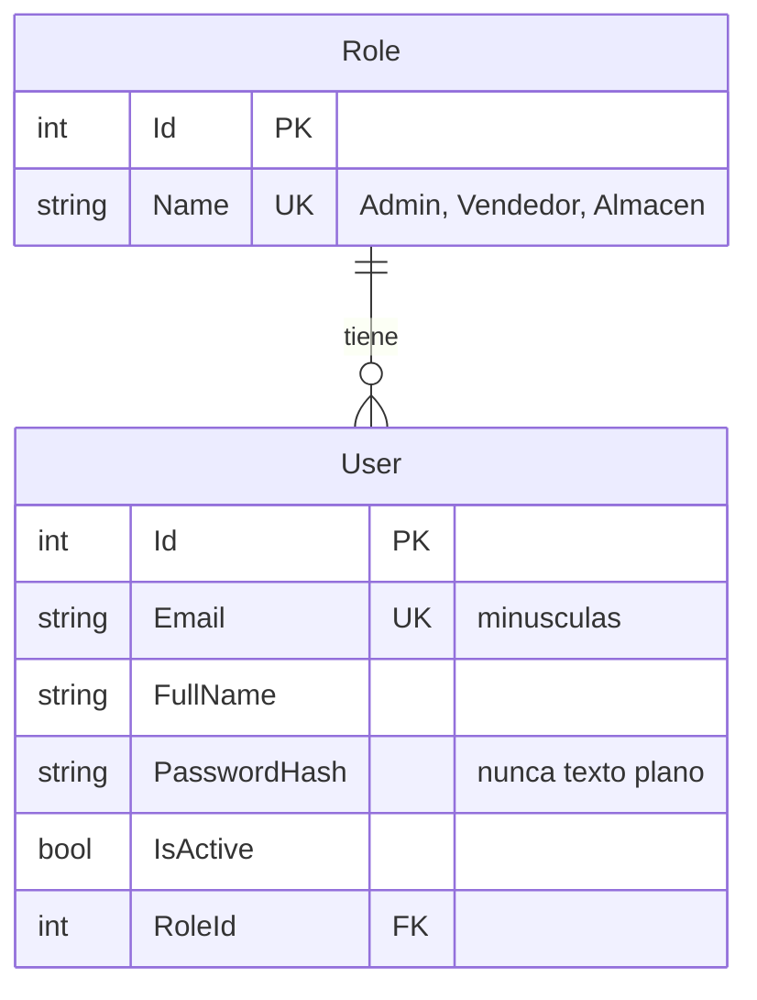

# API de Facturación e Inventario

API REST en ASP.NET Core para gestionar clientes, productos, facturas con ITBIS, control de stock, reportes de ventas y facturas en PDF. Proyecto de portafolio que demuestra buenas prácticas de backend: arquitectura en capas, transacciones, control de concurrencia, JWT con roles, paginación y logging estructurado.

> **Estado:** en construcción por sprints. Ver [CHANGELOG.md](CHANGELOG.md) y la carpeta [docs/](docs/).

## Requisitos

- [.NET SDK 11](https://dotnet.microsoft.com/download) (el proyecto apunta a `net11.0`)
- Docker (SQL Server 2022 en contenedor)
- `dotnet-ef` (`dotnet tool install -g dotnet-ef`)

## Configuración

### 1. Base de datos (SQL Server en Docker)

```powershell
docker run -d --name sqlserver-billing -e "ACCEPT_EULA=Y" -e "MSSQL_SA_PASSWORD=<TU_PASSWORD>" -p 1433:1433 mcr.microsoft.com/mssql/server:2022-latest
```

La contraseña debe cumplir la política de SQL Server (8+ caracteres, mayúsculas, minúsculas y números).

### 2. Secretos (no se guardan en el repositorio)

`src/BillingInventory.Api/appsettings.Example.json` muestra todas las claves necesarias. Los valores reales van en user-secrets:

```powershell
dotnet user-secrets set "ConnectionStrings:DefaultConnection" "Server=localhost,1433;Database=BillingInventory;User Id=sa;Password=<TU_PASSWORD>;TrustServerCertificate=True" --project src/BillingInventory.Api
```

Las claves `Jwt:Issuer`, `Jwt:Audience` y `Jwt:Key` se configuran de la misma forma (se usan desde el Sprint 2).

### 3. Migraciones

Aplicar las migraciones a la base de datos configurada:

```powershell
dotnet ef database update --project src/BillingInventory.Infrastructure --startup-project src/BillingInventory.Api
```

Crear una migración nueva tras cambiar entidades:

```powershell
dotnet ef migrations add <Nombre> --project src/BillingInventory.Infrastructure --startup-project src/BillingInventory.Api --output-dir Persistence/Migrations
```

### 4. Ejecutar y probar

```powershell
dotnet build
dotnet run --project src/BillingInventory.Api
dotnet test
```

Las pruebas de integración levantan su propio SQL Server en Docker (Testcontainers), por lo que Docker debe estar en ejecución. No usan tu base de datos de desarrollo.

## Swagger y salud

- **Swagger UI:** con la API en ejecución y `ASPNETCORE_ENVIRONMENT=Development` (perfil por defecto), abre `https://localhost:7257/` (redirige a `/swagger`). El JSON de OpenAPI está en `/swagger/v1/swagger.json`. En Producción Swagger no se publica.
- **Autenticación en Swagger:** el esquema Bearer (JWT) ya está definido; el botón *Authorize* se activa con los endpoints protegidos del Sprint 2.
- **Documentación:** los comentarios XML de `Api` y `Application` se incluyen automáticamente.
- **`GET /health`:** la API está viva (no consulta la base de datos).
- **`GET /health/ready`:** verifica la conexión a la base de datos; responde `503` si falla.

## Paginación, filtros y orden

Todos los listados aceptan los mismos parámetros en la query string:

| Parámetro | Descripción | Por defecto |
|---|---|---|
| `page` | Número de página (desde 1) | `1` |
| `pageSize` | Elementos por página (1 a 100) | `20` |
| `sortBy` | Campo de orden (lista blanca por listado) | definido por el listado |
| `sortDirection` | `asc` o `desc` | definido por el listado |

Cada listado añade sus propios filtros. Ejemplo de respuesta:

```json
{
  "items": [ { "id": 11, "name": "W11" } ],
  "page": 2,
  "pageSize": 10,
  "totalCount": 25,
  "totalPages": 3,
  "hasPrevious": true,
  "hasNext": true
}
```

Un `sortBy` no permitido o un `pageSize` fuera de rango devuelve `400` con el detalle por campo. Las enumeraciones se envían y reciben como texto.

## Errores y logs

- Todos los errores se devuelven como `application/problem+json` con `status`, `title`, `detail`, `traceId` y `correlationId`. Los errores de validación incluyen `errors` por campo.
- Cada respuesta incluye la cabecera `X-Correlation-Id`. Si envías esa cabecera en la petición (letras, números, `-` y `_`, máx. 64) se reutiliza.
- Los logs salen por consola y a `src/BillingInventory.Api/logs/billing-AAAAMMDD.log` en JSON (una línea por evento). El nivel se ajusta en la sección `Serilog` de `appsettings`.

## Estructura de carpetas

```
BillingInventory.slnx
├── src/
│   ├── Directory.Build.props          # reglas comunes: nullable, XML docs, warnings como errores
│   ├── BillingInventory.Api/          # controllers, middleware, configuración de la app
│   ├── BillingInventory.Application/  # servicios, DTOs, validaciones, interfaces
│   ├── BillingInventory.Domain/       # entidades y reglas de negocio
│   └── BillingInventory.Infrastructure/ # EF Core, repositorios, PDF
├── tests/
│   ├── BillingInventory.UnitTests/
│   └── BillingInventory.IntegrationTests/
└── docs/
    └── decisiones/                    # ADRs
```

Dependencias entre capas: `Api → Application, Infrastructure`; `Infrastructure → Application`; `Application → Domain`. `Domain` no depende de nada.

## Modelo de datos

Todas las entidades heredan de `BaseEntity` (`Id`, `CreatedAtUtc`, `UpdatedAtUtc`, `RowVersion`); en el diagrama solo se muestran los campos propios de cada tabla.



### Roles

| Rol | Uso previsto |
|---|---|
| `Admin` | Acceso total y gestión de usuarios |
| `Vendedor` | Clientes y facturas (rol del registro público) |
| `Almacen` | Productos e inventario |

## Decisiones de arquitectura

- [ADR-001: Arquitectura en capas](docs/decisiones/ADR-001-arquitectura-en-capas.md)
- [ADR-002: EF Core Code First con SQL Server](docs/decisiones/ADR-002-ef-core-code-first.md)
- [ADR-003: Manejo centralizado de errores y logging](docs/decisiones/ADR-003-errores-y-logging.md)
- [ADR-004: Paginación, filtros y ordenamiento](docs/decisiones/ADR-004-paginacion-y-ordenamiento.md)
- [ADR-005: Usuarios, roles y hash de contraseñas](docs/decisiones/ADR-005-usuarios-roles-y-contrasenas.md)
